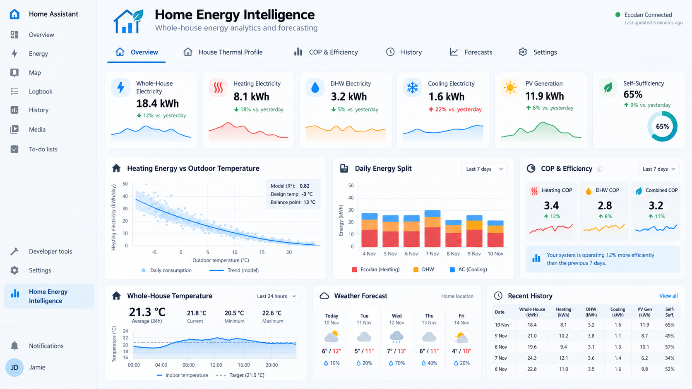

# Home Energy Intelligence

Home Energy Intelligence is a HACS-installable Home Assistant custom integration for validated daily whole-house energy records. V0.1 focuses on trustworthy collection and allocation: it does not estimate thermal production, COP, or weather-dependent forecasts.



## V0.1.1 features

- Overview defaults to today's actuals through the latest completed hour, with a same-cutoff yesterday comparison, full-yesterday reference, explicit partial/stale state and manual refresh. Its shared period selector updates KPIs, split, equipment and temperature views together.
- A single backend energy contract drives Overview, History and authenticated CSV export, including confirmed, assumed, selected, estimated, unknown, residual and discrepancy evidence.
- Compact idempotent hourly rows survive restarts and complement—not replace—the six-hour classification checkpoints and 05:00 authoritative daily close.
- History supports Home Assistant-timezone presets for Today, Yesterday, −2 through −7 days, Monday–Sunday weeks, seven completed days, calendar months/years, configurable energy seasons and custom ranges. Today is assembled from validated completed-hour rows at Overview's cutoff and is never written as a finalized daily record. Its authoritative summary covers the entire range independently of paginated detail rows, and CSV exports the entire selected range.
- Expected completed hours are checked individually, so internal gaps are visible and late Recorder data can safely replace poor-quality hourly rows without duplicating energy.
- Administrator diagnostics trace each representative temperature from stable source/entity mapping through live state, unit/attribute validation, bounded Recorder rows/statistics, rejection reasons and persisted hourly/daily coverage. A temperature-only repair can recover up to 31 days without replacing valid energy or stronger temperature evidence.
- Temperature repair queries only the affected temperature entities, skips complete sources before querying Recorder, uses an atomic source-aware SQLite merge and cannot block normal startup recovery if Recorder is unavailable.
- Missing allocations expose known partial subtotals separately and never become complete zero heating, DHW or cooling totals. Device-level heating/cooling evidence and signed reconciliation discrepancies remain visible.
- PV, grid and household history uses measured, physically valid balances and reports self-sufficiency/self-consumption only when its required inputs are available.
- Representative indoor and outdoor temperatures are independently selected by stable source ID. Matching cards show the latest validated value/timestamp, elapsed-time-weighted mean, min/max, coverage, quality and yesterday comparison; missing intervals remain timeline gaps.
- Period status reports date, meter, allocation and temperature coverage separately. Missing temperature dates reduce temperature coverage without invalidating otherwise valid electricity counters.
- The House Thermal Profile tab provides an evidence-bound **electrical** space-heating response curve normalized by configured floor area. It combines dynamically configured heat-pump and AC heating only for complete daily classifications. By default, a day also needs at least 95% representative-outdoor coverage and known reconciliation; the UI fits only after 10 validated days spanning at least 8 °C and reports R². Excluded dates and reasons remain visible. Measured thermal output, COP, design-day output and annualization remain unavailable unless their required evidence and complete period exist.
- Overview's heating/outdoor chart and House Thermal Profile use the exact same backend-qualified daily candidates and exclusion reasons.

## V0.1 foundation

- Guided General, Heat pumps, Air conditioners, Solar/grid, Temperatures, Weather, Data sources, and Data quality UI sections. Every source entity and operating-state mapping is configurable.
- Options Flow edits, disables or removes individual devices while preserving stable IDs, unrelated mappings and historical records.
- Options changes are transactional: skipping a section preserves all queued records, disabling retains the complete mapping, and only an explicit remove action deletes an item.
- Source values are normalized before calculation: Wh/kWh/MWh to kWh, W/kW to W, and °F to °C. Original source units remain in provenance.
- Recorder-first raw history and long-term-statistics reads, always off the event loop.
- Persisted six-hour, transition-aware allocations for any configured heat pumps and zero or more AC units; checkpoints are the primary daily classification evidence.
- Unknown heat-pump operation is `heating_assumed`; confirmed idle and raw reconciliation residual remain separate.
- True elapsed-time-weighted temperature mean/min/max with preceding-state lookup, missing coverage, freshness limits, and outlier rejection.
- DST-safe 23-, 24-, and 25-hour local days using the Home Assistant time zone.
- Idempotent 05:00 daily close and correction-safe catch-up in a dedicated compact SQLite database.
- Optional read-only InfluxDB 1.x backfill for explicitly mapped sources.
- Responsive Overview, History, and Settings panel with six-tab navigation. Deferred tabs never display invented measurements.
- Dashboard equipment is loaded dynamically. Authenticated users can view Overview, History and export their selected history range; source mappings and database details remain administrator-only. Database backup remains an administrator-only service.
- Sidebar registration is idempotent across config-entry reloads: one static route and one panel are maintained, and the panel is removed on final unload.
- Daily summary and quality sensors only; no duplicate high-frequency entities.

## Installation

### HACS custom repository

1. In HACS, open **Integrations**, choose **Custom repositories**, and add `https://github.com/igormesarec/home_energy_intelligence` as an Integration repository.
2. Install **Home Energy Intelligence** and restart Home Assistant.
3. Go to **Settings → Devices & services → Add integration** and select **Home Energy Intelligence**.
4. Add each heat pump and optional AC with a display name, electrical counter, power and operating-state entity. Map the installation's state strings to the documented categories.
   Energy counters must use the `energy` device class, Wh/kWh/MWh and `total` or `total_increasing`; power sources must use the `power` device class and W/kW.
5. Add optional PV/grid, temperature and weather sources. Temperature sources accept °C or °F and each has its own physical limits, invalid sentinels, spike limit, point-sample freshness and missing-data thresholds.
6. In **Data quality**, explicitly choose one representative indoor source and one representative measured outdoor-air source, or leave either as **Not configured**. Use **Test representative sources** to preview the current normalized value, unit validation, quality and last update before saving. A weather entity, supply-water sensor or return-water sensor is never silently selected as outdoor air. The same section configures the minimum outdoor-temperature coverage used by the electrical response profile (95% by default).
7. Review Recorder-first historical collection; enable read-only InfluxDB backfill only if needed.
8. Confirm the Home Assistant time zone. Completed-hour rows refresh shortly after every hour, six-hour checkpoints preserve classification evidence, and the previous calendar day is finalized at 05:00 local time.
9. If a previously mapped representative sensor has blank historical cards, open the dashboard **Settings**, load **Temperature pipeline diagnostics**, then run the bounded repair after confirming Recorder still has valid history. Missing Recorder intervals remain gaps.

For a manual install, copy `custom_components/home_energy_intelligence` into the Home Assistant configuration directory's `custom_components` folder, then restart.

Before updating an existing installation, create the administrator-only protected
database backup. Startup integrity-checks the database and transactionally
migrates V1–V3 storage to schema V4, which normalizes temperature audit data.
Do not downgrade an already migrated database to a V3 writer; restore the backup
if rollback is required.

## Safety and privacy

The integration never writes to Recorder or InfluxDB, changes retention, or modifies source entities. It stores only compact derived checkpoints and daily records under:

```text
<config>/.storage/home_energy_intelligence/home_energy_intelligence.sqlite3
```

Do not map the same physical counter more than once. Circuit 2K is explicitly rejected for supply/return mapping. Missing return temperature remains missing: the integration never substitutes another circuit. V0.1 never derives thermal energy from electricity.

## Services

- `home_energy_intelligence.reprocess_date`: rebuild one day.
- `home_energy_intelligence.reprocess_range`: rebuild up to 31 days.
- `home_energy_intelligence.export_database`: administrator-only consistent backup under `<config>/.storage/home_energy_intelligence/exports`; it is never exposed through `/config/www`.

## Development

Use Python 3.13 or the Python version required by the targeted Home Assistant release:

```bash
python -m pytest
python -m compileall -q custom_components tests
node --check custom_components/home_energy_intelligence/frontend/hei-panel.js
```

See [testing](TESTING.md), [data quality](DATA_QUALITY.md), [schema](DATA_SCHEMA.md), [entity mapping](ENTITY_MAPPING.md), and [InfluxDB backfill](INFLUXDB_BACKFILL.md).

The [V0.1.1 post-merge correction report](docs/V0.1.1_POST_MERGE_CORRECTION_REPORT.md) records the audited root causes, compatibility assessment, responsive layout evidence and manual backed-up Home Assistant checklist.

## Scope

- **V0.1:** validated electricity, temperature, source quality, and basic dashboard/history/settings.
- **V0.1.1:** whole-house electrical heating-response evidence; no thermal output is inferred.
- **V0.2:** manually or natively sourced thermal energy, thermal response, and correctly weighted COP.
- **V0.3:** weather sources and probabilistic forecasting.

License: MIT.
